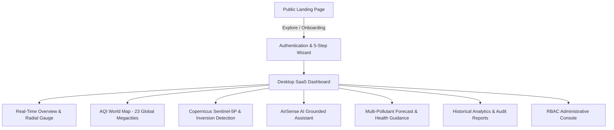

# Urban-Air-Quality-Assistant 🌍💨

> **Breathe Smarter. Live Healthier. Build Cleaner Cities.**
> A production-grade Environmental Intelligence SaaS platform featuring real-time planetary AQI surveillance, interactive Leaflet world maps, Copernicus Sentinel-5P satellite sounding, boundary layer thermal inversion detection, Koschmieder optical visibility calculations, and grounded Google Gemini AI health recommendations.

[](LICENSE)
[](https://react.dev/)
[](https://www.typescriptlang.org/)
[](https://fastapi.tiangolo.com/)
[](https://tailwindcss.com/)
[](https://leafletjs.com/)
[](https://deepmind.google/technologies/gemini/)

---

## 📸 Platform Overview

The **Urban Air Quality Assistant** platform connects citizens, atmospheric scientists, and urban planners directly to physical environmental telemetry and AI diagnostics:



---

## 🌟 Key Features & Capabilities

### 1. 🌐 Interactive AQI World Map
- **Global Coverage**: Real-time physical telemetry for 23 global megacities across North America, Europe, Asia, Latin America, Africa, the Middle East, and Oceania.
- **Atmospheric Heatmap Rings & Streamlines**: Visualizes particulate plume dispersion and wind vector streamlines.
- **Watermark-Free Dark & Light Canvas**: High-contrast Esri Dark Gray and Light Gray base maps designed specifically for environmental data visualizations.
- **Continental Filtering & Global Leaderboards**: Live comparative rankings for the cleanest and most polluted metropolitan hubs.

### 2. 🔬 Deep-Tech Atmospheric Science & IoT Engine
- **Copernicus Sentinel-5P TROPOMI Satellite Sounding**: Tropospheric vertical column densities for $\text{NO}_2$, $\text{SO}_2$, $\text{CO}$, and UV Aerosol Absorbing Index (AOD).
- **Planetary Boundary Layer Thermal Inversion Detector**: Calculates vertical temperature lapse rates (surface vs 500m aloft) to identify trapped urban air pollution episodes and ventilation mixing heights.
- **Koschmieder Optical Atmospheric Visibility Calculator**: Dynamic light extinction coefficient ($\beta_{ext} = \beta_{ray} + 0.003 \cdot [PM_{2.5}] \cdot f(RH)$) calculating optical horizon range in kilometers.
- **Clean Air Commute Inhaled Dosage Simulator**: Biological lung intake model ($\text{Dose } (\mu g) = C_{eff} \times \dot{V}_{vent} \times t$) comparing Greenway vs Arterial vs Highway routes across Cycling, Walking, Car, and Subway transit.
- **AI Chemical Source Attribution**: Spectral mass balance chemical fingerprinting estimating relative pollution contributions (Vehicular fleet, secondary nitrates/sulfates, biomass burning, marine aerosols).
- **IoT LoRaWAN Sensor Mesh Telemetry**: Live micro-sensor monitoring with battery millivolts, RSSI (dBm), packet loss percentages, SNR, and laser optical calibration status.

### 3. 🎙️ AirSense AI Assistant & Speech Synthesis
- **Grounded AI Conversations**: Powered by Google Gemini with fallback atmospheric reasoning, explicitly separating `[MEASURED OBSERVATION]`, `[MODEL FORECAST]`, and `[AI SCIENTIFIC EXPLANATION]`.
- **Audio Voice Briefing**: Native Web Speech API speech synthesis vocalizing real-time atmospheric summaries with sound wave animations and playback speed controls.
- **Voice Input Dictation**: Speech recognition enabling voice queries.

### 4. 📊 Multi-Pollutant Analytics & Regulatory Standards
- **Standards Switcher**: Seamless switching between **US EPA AQI**, **WHO 2021 Health Ceilings**, **European Air Quality Index (EAQI)**, and **Indian National AQI (NAQI)**.
- **6 Key Contaminants**: Continuous tracking for $\text{PM}_{2.5}$, $\text{PM}_{10}$, $\text{NO}_2$, $\text{SO}_2$, $\text{CO}$, and $\text{O}_3$ with regulatory thresholds and 24h delta indicators.
- **Temporal Retrospective**: Historical oscillation charts, inter-city comparative benchmarking, and 1-click CSV/PDF audit report export.

---

## 🏛️ Architecture & Technology Stack

| Layer | Technologies |
| :--- | :--- |
| **Frontend** | React 19, TypeScript, Vite, Tailwind CSS v4, Lucide Icons, Recharts, Leaflet, Framer Motion |
| **Backend** | Python 3.11+, FastAPI, Pydantic v2, SQLAlchemy 2.0, Uvicorn, Python-Jose (JWT), Bcrypt |
| **Telemetry Providers** | Open-Meteo Air Quality API, Copernicus CAMS Global Ensemble, In-situ EPA/Defra/CPCB Reference Networks |
| **Satellite & Physics** | Copernicus Sentinel-5P TROPOMI, Koschmieder Optical Physics, Boundary Layer Inversion Models |
| **AI Reasoning** | Google Gemini Multimodal API & AirSense Atmospheric Dispersion Engine |
| **Database** | SQLite (Default with automatic seeding) / PostgreSQL compatible |
| **Containerization** | Docker, Docker Compose, Nginx Reverse Proxy |

---

## 🚀 Live Access & Quickstart

### Prerequisites
- Node.js 18+ & npm
- Python 3.10+
- Git

### Quick Setup

```bash
# 1. Clone the repository
git clone https://github.com/Ranjeet7680/Urban-Air-Quality-Assistant.git
cd Urban-Air-Quality-Assistant

# 2. Setup Backend
cd backend
python -m venv venv
# Windows:
venv\Scripts\activate
# Linux/macOS:
# source venv/bin/activate

pip install -r requirements.txt
python run_server.py

# 3. Setup Frontend (in a separate terminal)
cd ../frontend
npm install
npm run dev
```

The application will be live at:
- **Frontend Dashboard**: `http://127.0.0.1:5174` (or `http://localhost:5173`)
- **Backend API**: `http://127.0.0.1:8005`
- **Swagger Documentation**: `http://127.0.0.1:8005/docs`

### Demo Credentials
| Role | Email | Password |
| :--- | :--- | :--- |
| **Citizen User** | `sarah.chen@urbanair.io` | `UserPass123!` |
| **Lead Administrator** | `admin@airsense.eco` | `AdminPass123!` |

*(Instant One-Click Demo Access buttons are also available on the Login screen).*

---

## 🧪 Automated Verification Suite

Run the full end-to-end regression test suite:

```bash
python tests/test_api.py
```

Validates all 9 core subsystems:
1. System Health & Database Connectivity
2. Real-Time AQI Telemetry Ingestion
3. Monitoring Stations Spatial Directory
4. 24-Hour & 7-Day Atmospheric Forecasting
5. JWT Authentication & Password Security
6. Grounded AirSense AI Reasoning Engine
7. Regulatory Audit Report Generation
8. Role-Based Access Control Admin Dashboard
9. Copernicus Sentinel-5P & Deep-Tech Inversion Engine

---

## 📜 License

This project is licensed under the MIT License - see the [LICENSE](LICENSE) file for details.
